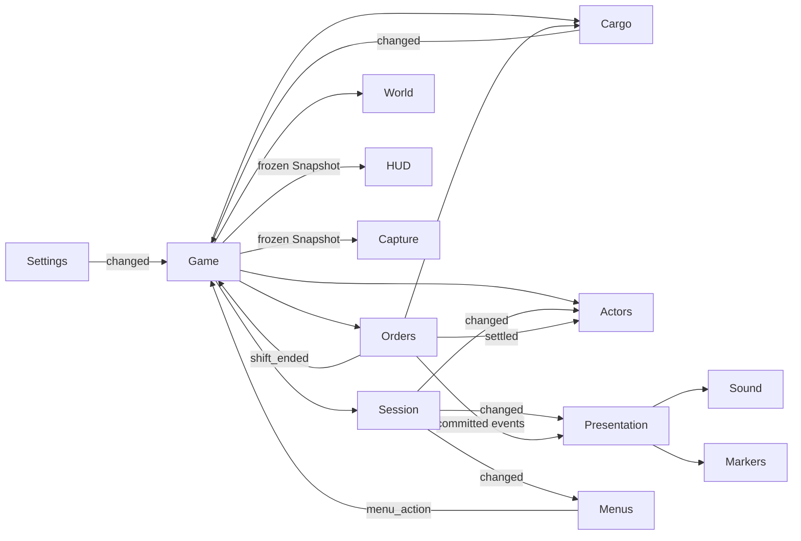

# Gameplay ownership (Phase 03)

Game is the composition root and current distance-based interaction coordinator.
It creates/configures scene-local owners, connects their explicit signals and
exposes compatibility commands. It does not own a second copy of order, cash,
cargo, pause or seated state. No global event bus or empty future managers exist.

| Concern | Real owner | State / interface |
| --- | --- | --- |
| Session/input | `services/session_service.gd`, `session_input.gd` | TITLE/PLAYING/RESULT, generation, modal reason set; input commands always process while the world is paused. |
| Tickets, deadlines, settlement | `services/order_service.gd` | Per-order ID, destination, quantity, lifecycle and ticket state; prep/freshness clocks, seeded selection, timeout/settlement and payment ledger. |
| Physical cargo | `services/cargo_service.gd` | Stable package IDs, order bundles, exactly one location per package, van-slot assignment, Pip/van capacities, visuals and global invariants. |
| Actor mode/control | `services/actor_controller.gd` | FOOT/DRIVING, exclusive control flags, stop/entry/exit probes, reset and camera target handoff. |
| World references/identity | `services/world_registry.gd` | Validated house, shop entrance/counter/staff/stock, pickup compatibility and spawn/body references; stable address lookup; no order/session state. |
| Interaction | Game `interact()` | Existing distance/range selection delegates to order/actor commands; a shared validated target pipeline belongs to Phase 06. |
| Camera | `camera_rig.gd` | One rig with TITLE_ORBIT/FOLLOW/CHASE/FREE modes. ActorController supplies target/driving, SessionService supplies flow/pause, Balance supplies tuning. Free view freezes play through the `free_camera` modal reason and drives its own `free_*` actions; nothing else moves the camera. |
| View/effects | `services/presentation.gd`, `sound_presenter.gd` | Derived text/waypoints, markers, sound/toasts/results from committed events. No pay/deadline mutation. |
| HUD/tests | `services/game_snapshot.gd` | Typed frozen values with no Node/service handles; HUD receives only a Callable supplying this read model. |
| Menus/navigation | `ui/menu_layer.gd` | Pooled full-screen cards, the visible screen stack and menu focus. Emits `menu_action(id)` for Game to execute; never writes session, order or actor state. |
| Preferences | `services/settings_service.gd`, `services/input_bindings.gd` | `user://settings.cfg`: audio/window/UI scale/camera/text plus remapped actions. Load/save/validate/reset and applying live values are the service's job, not a menu's. |
| Balance configuration | `data/balance.tres`, `services/balance.gd` | Shared Resource: ranges, short shop preparation, deadline floor/start/decrease, pay/tip/goal/strikes, stop/exit thresholds. Never mutated during play. |

All service paths above are under `scripts/`. Later traffic/time/weather/story,
progress and save owners should consume stable IDs/committed events. Their
managers and persistence schemas are deliberately not implemented in this refactor.



## Session and lifetime

`SessionService.Flow` is TITLE/PLAYING/RESULT. Modal reasons are independent of
that base flow. `open_modal(reason: StringName)` and `close_modal(reason)` return
bool; multiple different reasons can coexist. Closing one cannot resume another.
An empty reason, duplicate open or unknown close is rejected. `toggle_pause()`
owns only `user_pause`. The effective snapshot session_mode is title/playing/
paused/result; order_lifecycle and actor_mode remain separate fields.

`reset()` increments generation, clears reasons and returns to title. `start()`
starts only from title; `finish(win)` returns to result only from unpaused play.
`changed(event: Dictionary)` emits a read-only value containing flow, generation,
paused and outcome. It also applies the tree pause state. Only SessionInput,
Session, HUD and the camera rig (free view and its modal) need always-processing
behavior; Game/world stay pausable.
Exiting the service tree clears inherited tree pause for a replacement scene.

One Game instance creates one set of services and signal connections. Reset
reuses them, never reconnecting. Scene destruction removes the entire owner graph;
no cached service/node pointers or connections survive in an autoload. Game reset
prepares OrderService and actors before publishing the new session generation,
so subscribers cannot observe a new title generation with the old cash/cargo/body.

## Camera and player view

`camera_rig.gd` is the single owner of the player view. ActorController keeps its
existing contract (`target`, `driving`, `orbit`); the rig derives one mode from
that plus session flow:

| Mode | When | Manual controls |
| --- | --- | --- |
| TITLE_ORBIT | Session flow is TITLE | None; the diorama keeps orbiting |
| FOLLOW | Playing on foot | Drag/right-stick look, wheel zoom, C recenter |
| CHASE | Driving | Same, plus recenter behind the van after an idle grace |
| FREE | `free_camera` modal open | `free_*` movement and mouse/pad look |

Look input uses the `cam_orbit`, `cam_left/right/up/down` actions (mouse
right-drag, right stick, optional inverted Y); zoom uses `cam_zoom_in/out` with
per-mode minimum/maximum/default distance and pitch; `cam_recenter` (C) eases the
pose behind the followed actor; `cam_free` (F) toggles the free view.
`tools/setup_project.gd` is the generator of record for every binding, so
keyboard, mouse and joypad events survive project regeneration; `run_checks.py`
regenerates settings before the camera checks.

The boom is collision-aware: a sphere sweep against WORLD/VEHICLE from the
head-height pivot shortens the requested distance, and a pivot that already
overlaps geometry collapses to the mode's minimum boom instead of exploding.
Pull-in applies immediately while extension eases, and the followed actor only
gets a slight see-through fade (FOLLOW, inside 4.5 m) when the camera is close.
Losing window focus mid-drag drops the drag and hands the captured cursor back.

While any other modal owns pause the rig ignores camera actions entirely; it is
the only consumer of the `cam_*` actions. The free camera is the one exception:
`open_modal(&"free_camera")` freezes the world like the pause modal, the rig
keeps its own actions live through PROCESS_MODE_ALWAYS, and exiting restores the
saved target/mode/pose, play state and cursor. Restart, session end or an
external modal clear force-closes it. The snapshot publishes `camera_mode`
(title/foot/chase/free) and an empty `camera_hint` except while free, which the
HUD renders as the controls line.

## Menus, preferences and free roam (Phase 05)

`ui/menu_layer.gd` (a CanvasLayer above the HUD) owns one pooled `Control` per
screen — title, pause, results, credits, confirm, message, options, controls.
`_stack` is the visible stack: `_show_only(id)` for TITLE/RESULT, `_push/pop`
for everything else, and every screen is a full-rect `ScrollContainer` +
`CenterContainer` card so an enlarged UI scale scrolls instead of hiding an
action. Screens are transparent to state: buttons call `activate(id)`, which
either pushes/pops (menu ids) or emits `menu_action(id)` for Game to execute
game ids (`start_shift`, `start_roam`, `resume`, `restart_shift`,
`return_to_title`, `quit`). Confirm dialogs remember their pending game id in
`_pending` and only then emit it.

Esc is a single back stack owned by `SessionInput` -> `Game.handle_back()`:
an open menu first (subpanels, then the screen below it), then the free camera,
then the pause toggle, then results -> title. `R` stays an instant restart
shortcut while paused, at the results screen or at the title, and is ignored
during an active shift. The rebindable `confirm` action is a second route into
the focused menu button, used only when a rebind makes it differ from the
builtin `ui_accept` that Enter already triggers. The HUD keeps in-game
furniture only (cash, objective, waypoint, timer, strikes, prompt, toasts); it
hides all of it at the title and results screens, and the pause screen is a
menu, not a HUD card.

Free roam is a session mode, not a separate scene: `SessionService.mode` is
`"shift"` or `"roam"` and `roaming()` is true only while playing in roam. It
starts through the same `start()` path, so camera/actor/order wiring is
unchanged, but the run has no ticket, no deadline and no strikes: the HUD hides
cash, objective, timer and strikes and shows a `FREE ROAM · no clock` hint.
The shop counter and house doors stay dormant in roam while van entry still
works, so exploring cannot create, deliver or fail a ticket. A restart from the
pause menu keeps the mode the player chose (roam restarts roam, a shift
restarts a shift) and the results screen can only be reached from a shift.

`services/settings_service.gd` owns `user://settings.cfg` and the only live
accessor is `value(key)`. `DEFAULTS`/`SPEC` declare every key with type, range
and default; `load_settings()` validates stored values key by key (wrong type or
out-of-range falls back to the default or the nearest legal value), so a
half-written or edited file can never break startup. Audio, window mode, UI
scale and InputMap are applied by the service itself; camera, sun shadows and
text speed are applied by Game when the service emits `changed`. `configure(path,
autosave)` lets checks and probes write to their own file instead of the real
one. `services/input_bindings.gd` serializes/deserializes the map, reports
conflicts (skipping `ui_*`), keeps critical movement actions always bound and
produces the prompt labels the HUD and controls screen show.

## Render target and quality presets (Phase 05b)

The project ships on **Forward+**: `tools/setup_project.gd` writes
`rendering/renderer/rendering_method`, so regenerating `project.godot` cannot
silently drop it, and a 1920 × 1080 default window; `msaa_3d = 2` (4 ×), a 4096
directional shadow atlas with soft-shadow filter quality 3, and an Environment
with AgX tone mapping, SSAO and glow. This is the RTX 3050 6 GB laptop target;
the earlier Compatibility baseline and the 1280 × 720 target were replaced on
purpose.

`video/quality` (`low`/`medium`/`high`) is a **macro**: `set_value` routes it to
`_apply_quality_preset`, which writes the fine-grained keys (`video/msaa`,
`video/ssao`, `video/glow`, `video/shadows`, `video/shadow_quality`,
`video/frame_cap`) through `set_value` itself. Every value a preset writes keeps
its own row, its own stored value and its own apply path, so no option is
decorative. Ownership follows the existing split: the service applies
renderer-global pieces (MSAA on the root viewport, the SSAO quality/half-size
project keys, the shadow atlas, `Engine.max_fps`) while Game applies scene-owned
Environment and sun keys from the `changed` signal. `Engine.max_fps` is forced to
0 without a real window, so headless checks keep simulating faster than real
time.

Rows that change from elsewhere must follow along: `ui/options_screen.gd` keeps a
per-key refresher, `MenuLayer._refresh()` calls `refresh_values()` on the screen
it is about to focus, and the options list sizes itself to the current logical
view (`_fit_scroll`) so the same card fits a 150 % UI scale on a 720p window and
uses the full card height at 1080p.

`tools/perf_probe.gd` is the measurement harness phases 20 and 23 build on: a
fixed route (walk with the real follow camera), fixed seed, chosen quality tier
and resolution, a scratch settings file, and a report of frame-time percentiles,
hitches (> 2 × median), draw calls, primitives, nodes and static memory. It never
touches `user://settings.cfg`, and headless runs print `PERF HARNESS OK` instead
of timings.

## Orders and transaction boundaries

`OrderService` (`scripts/services/order_service.gd`) owns ticket lifecycle and
settlement; `CargoService` (`scripts/services/cargo_service.gd`) owns package
identity and location. Stable order IDs are monotonic within a session
generation. Package IDs are `g{generation}-o{order}-p{index}` and each bundle
stores the destination ID and quantity. Lifecycle is `IDLE`, `AT_SHOP`,
`ON_ROUTE`, `CLOSED`; ticket state is `NONE`, `PREPARING`, `READY`, `COLLECTED`.

Order APIs include `set_seed(value)`, `reset(generation)`,
`force_destination(id, available)`, `create_ticket(available)`,
`queue_ticket(available, select_after=false)`, `can_queue(available)`,
`pickup_order(order_id)`, `select_order(order_id)`,
`settle_order(available, generation, order_id, customer_id)`,
`expire_order(available, generation, order_id)`, `order_data(order_id)`,
`outstanding_order_ids()`, `tip(order_id)`, `tick(delta, available)` and
`close()`. At most three active orders are accepted by default. Preparation and
freshness are separate clocks; freshness starts only after a complete counter
to-Pip transfer. Queue admission checks reserved package capacity and a route
estimate. The current fallback is Euclidean distance × 1.55 divided by
`Balance.conservative_route_speed`, plus `Balance.route_parking_allowance`;
Phase 09 replaces this callback with directed road-graph costs.

Cargo APIs include `create_order(generation, order_id, destination_id,
quantity)`, `package_ids(order_id)`, `location_for_order(order_id)`,
`count_for_order(order_id, locations)`, `transfer_order(order_id,
expected_location, next_location)`, `settle_order(order_id, quality)`,
`discard_order(order_id)`, `select_next_van_order()`, `inventory_lines()` and
`invariant_errors()`. Locations are `counter`, `pip`, `van`, `customer` and
`discarded`. Transfers check expected ownership and capacity before mutating the
bundle. Pip carries up to three packages; the van has six numbered slots.
`changed(event)` publishes a read-only summary of action, order and aggregate
counts. `Game` is the only coordinator that connects lifecycle commits to cargo
transitions and world interactions.

Order signals `ticket_created`, `ticket_ready`, `picked_up`, `receipt_created`,
`settled`, `timed_out` and `shift_ended` carry read-only dictionaries. Settlement
events itemize `base_pay`, `pizza_pay`, `tip_pay`, `quality_adjustment` and
`settlement_total`. `settle_order` validates generation, order, destination,
lifecycle, deadline and complete Pip ownership before moving packages to the
customer and crediting money. Timeout moves every package to `discarded`, frees
van slots and adds one strike. Both paths are idempotent; a restart clears the
run's package ledger. Wrong-address dialogue has no order commit.

The customer-quality ratio is remaining time divided by the deadline. Tip is
proportional to remaining time; named Balance settings control base/per-pizza
pay, quality thresholds and adjustment. OrderService owns current prototype
money until a later progress ledger exists. `close()` discards outstanding
packages and cancels run work. Rendering adapters observe stable IDs and
outcomes, never settle tickets.

## Shop receiving (Phase 07)

`tools/build_art.py::shop()` is the source for the enterable shop: front-wall
colliders leave a doorway, the counter collider separates the public queue from
the kitchen, and the oven, pickup shelf, OPEN/order-pickup signs and warm light
are generated alongside the shell. `tools/build_town.py` rotates that scene and
keeps `Town/PizzaShop/PickupPoint` as a compatibility alias at the counter. New
gameplay uses `CounterAccess`, `StaffStation`, `ShopEntrance` and `ReadyStock`.
Mona is placed at `StaffStation`; the `shop.counter` interaction is anchored at
`CounterAccess`, is foot-only and requires range, facing and clear world sight.

Ticket preparation is a short Balance value. It advances while the unpaused
world runs, freezes under dialogue/pause, and publishes `ticket_ready`; ready
stock appears in a quantity matching the order. The HUD ticket card shows order
ID, stable address, customer label, quantity and PREPARING/READY/COLLECTED state.
The shop conversation can leave a ticket unchanged; only its commit calls the
guarded pickup. The immutable `receipt_created` payload contains the order ID,
quantity, destination, deadline and current package ownership. `picked_up` stays
available for existing presentation integrations.

## Physical cargo (Phase 08)

The rear cargo interaction is independent from the driver-door and seat targets.
E transfers a whole selected order between Pip and the van; it never changes the
order's route lifecycle. Tab cycles among bundles in the van while Pip is at the
cargo door. The six rear indicators show occupied slots, order labels are
attached to the visible carton stacks, and the HUD inventory lists each active
order's address, quantity and location. The rendered cargo-handoff plan is a
visual fixture; `tools/phase08_route_checks.gd` separately verifies the normal
counter → van → customer path using player and driving inputs, with no teleports
or actor autopilot.

## Interactions and conversations (Phase 06)

One target table replaces per-action distance checks. `InteractionService`
(`scripts/services/interaction_service.gd`) owns the registry; Game registers the
five shipped targets, each with an anchor (a Node3D or a Callable returning one,
so a moving actor or a replaced placeholder needs no re-registration), a `label`
(String or Callable), an `on_activate(Callable) -> bool`, optional `enabled` and
`reason` gates, an optional `active` gate, a `range` in metres from the approach
point, a `priority`, `modes` (actor modes allowed to use it), `access` (the local
offset of the approach point) and optional `view`/`facing`/`los` sampling.

`select()` runs the deterministic query — `enabled desc → priority desc →
distance asc → id asc` — over the entries that are active, mode-compatible, within
`range`, at `|dy| <= 2.5` and sighted (a single ray on `Layers.WORLD` between the
observer's eye and the approach point, with the observer's own RID excluded, so
vehicles and people never blind a prompt). `prompt_view()` is one query that
returns both `{text, id}`; the HUD and the snapshot read it, and `activate()` runs
the same entry's action, so the prompt and the action cannot disagree. A blocked
target still wins the query and shows its `reason` (`COUNTER CLOSED`,
`HANDS FULL`, `NOTHING TO DELIVER`, `WRONG ORDER`, `STOP THE VAN TO EXIT`) instead
of the action label, and `activate()` refuses it. A deleted or out-of-tree anchor
drops the entry from the query on the next frame.

`DialogueService` (`scripts/services/dialogue_service.gd`) loads
`data/dialogue/*.json` from an explicit `FILES` list and validates each file plus
the set: JSON types and shapes, unknown conversation/node/choice/effect/condition
fields, speaker colour format, unique conversation and node ids, every `next` and
choice target, unreachable nodes, nodes with no path to an exit, a last entry that
is not the unconditional fallback, `order` effects outside a commit node and
unknown order commands/tokens. `validate_set()`/`validate_conversation()` are
static and read-only; `tools/check_dialogue.gd` proves the shipped files clean and
each rejection class reported, including malformed shapes that must not crash.

Runtime rules: `start()` resolves the first matching `entry` (conditions are
`flag`, `cargo`, `deliveries`, `lifecycle`, `mode`, `ticket`), opens the modal reason
`dialogue` and reveals the node's text; `advance()` reveals a partial line, then
advances or ends a line node, and never advances a node with choices; `choose(i)`
applies that choice's non-order effects and enters its target (an empty `next` is
the authored exit); `end()` applies the node's `order` effects exactly once and
closes with the node's `commit` id; `cancel()` only works for conversations whose
`cancel` is `close`. A single press cannot both open and advance a session (frame
latch), and a session closes if its owning target, its generation or the playing
flow goes away, so a freed actor can never leave input hung. `reset()` drops the
session and clears the story flags; money and cargo are only ever moved by the
commit path, which calls the guarded OrderService commands.

`MenuLayer` treats `dialogue` as one more pooled screen: it trims menus above the
conversation, `Esc` calls the screen's `handle_back()`, and a transactional
conversation (cancel `pause`) keeps the session and stacks `user_pause` above it.
`SessionInput` keeps `interact` enabled while a conversation owns the pause and
does not swallow it, so the same key reveals, advances and confirms.

## Identifiers and compatibility

A destination's stable string ID is its validated unique `address_id` metadata,
for example `2 Marinara Way`. For the first eight deliveries it intentionally
matches the original display address so active callers and capture plans remain
compatible. It is independent of child index/order; changing an ID is an
intentional migration. Labels and display addresses are presentation data. Ticket
identity is `(session generation, order_id)`; order_id increments within a run
and resets at title restart. No live Node pointer belongs in future save data.

`data/world/world_layout.json` is the generated runtime catalog; `tools/world_data.py`
is its source of truth for bounds, districts, address lots, roads, pedestrian links,
POIs, spawns, actor clearance and collision classes. It is serialized with stable
ordering and the decoration stream is seeded separately from gameplay RNG.
WorldRegistry `ids()`, `address(id)`, `destination(id)`, `address_record(id)`,
`marker(id)`, `register_marker(id, kind, node)` and `unregister_marker(id)` expose
active IDs. `registration_changed(event)` emits `{id, kind, registered}`. Only
`legacy_id(index)` depends on the Phase 03 eight-address order. Capture's old
`order.index` remains a documented compatibility adapter; new correctness plans
use `order.destination_id`. The choices passed to OrderService are stable IDs,
not numeric scene positions. Registry lookup validates unique nonempty addresses
and the existing Door/Park/pickup/spawn/collision contracts. `destination(id)`
also accepts the old display address during migration.

`WorldGraphService` loads the same catalog. Directed `road_graph.lanes` use metres,
lane width, speed class, turn permissions, junction ID, vehicle type and +Z-based
`yaw_deg`; `pedestrian_graph.edges` are separate sidewalk, crossing, lot-path and
door-threshold links. `nearest_legal_entry(position, vehicle_type)` returns a
legal directed lane projection. `vehicle_route(position, address_id, closed_lanes)`
returns `{reachable, road_distance_m, walk_distance_m, road_path, reason}` and
reports closed/disconnected destinations explicitly. `route_seconds()` adds the
configured conservative road speed, final walking speed and parking allowance.
Every delivery parking and door marker is checked for graph connectivity.

Phase 10 catalog schema 2 covers a 320 × 240 m island and five districts:
Downtown (8 addresses), Cedar Grove, Harborfront, Summit Hill and Market Works
(9 each). Forty-four lots include homes and deliveries for a clinic, harbor
office, summit lodge, market stall and workshop. Each lot records its door,
parking approach, customer slot, access path and district. Physical road and
sidewalk slabs are generated from the same source segments as their graphs;
water and coast edges have matching barriers, and each district has a recovery
anchor. The generated map contains 440 directed van lanes and 2,270 pedestrian
links. Route-time figures in `tools/validate_world.py` are graph estimates at
4.2 m/s plus an 8-second parking allowance, not measured drive times. The
Phase 10 traversal check separately walks and drives the district loops using
ordinary movement input.

Collision layers remain environment=1, player=2 and vehicle=4; the player mask
is environment|vehicle and the van mask is environment. The catalog records the
same matrix: building bodies, road barriers, water and authored fence barriers are
solid world geometry; foliage is decorative; doorstep markers are interaction
thresholds. The authored player capsule is 0.34 m radius × 1.9 m high and the van
box is 2.0 × 2.4 × 3.85 m. Lane clearance and junction turn radius are validated
against those dimensions. `docs/world_graph.dot` diagrams road directions, walking
links, address access and blocked water.

Game exposes `start_shift() -> bool`, `interact()`, `restart()`,
`force_destination(id) -> bool`, `open_modal(reason)`, `close_modal(reason)`,
`get_snapshot() -> GameSnapshot` and `set_order_seed(value)`. Existing underscore
methods/legacy State/getter fields remain compatibility adapters for Phase 01
fixtures. New consumers should not write them. The legacy combined mode strings
remain in diagnostics so the Phase 02 assertion schema is preserved.

GameSnapshot exposes typed computed getters and a read-only internal dictionary.
It contains primitives/Vector3/Color values only. `to_dictionary()` is an isolated
JSON-compatible copy; changing it cannot change a snapshot or gameplay owner.
HUD gets no mutable Game/service reference. Phase 02 fields remain; additional
fields are generation, session_mode, actor_mode and order_lifecycle. Derived HUD
text, actor position and waypoint values use the same snapshot contract.

`tools/dev_fixture.gd` contains explicit test-only money/timer/mode injection,
teleport/autopilot, expiry/retry/result and teardown adapters. Capture imports it
only for an explicitly requested developer plan; ordinary gameplay never imports
it. `phase01_checks.gd` remains an isolated physics fixture and may inject body
velocities/colliders or restrict the registry for negative tests. Such hooks do
not establish player navigation or authorize arbitrary mutation in JSON.

## Regression commands

```sh
python3 tools/run_checks.py
python tools/validate_world.py --layout data/world/world_layout.json --diagram docs/world_graph.dot
godot --headless --audio-driver Dummy --path . --script tools/world_graph_checks.gd
godot --headless --audio-driver Dummy --path . --script tools/phase03_checks.gd
godot --headless --audio-driver Dummy --path . --script tools/phase04_checks.gd
godot --headless --audio-driver Dummy --path . --script tools/phase05_checks.gd
godot --headless --audio-driver Dummy --path . --script tools/check_dialogue.gd
godot --headless --audio-driver Dummy --path . --script tools/phase06_checks.gd
godot --headless --audio-driver Dummy --path . --script tools/settings_probe.gd -- --mode=write
```

The full suite includes original 137 physics/state assertions, typed snapshot/
modal/transaction/reload checks, order RNG isolation, settings regeneration
through `tools/setup_project.gd`, 58 camera checks, 214 menu/settings/free-roam
assertions, a three-process preferences persistence probe, repeated one/two-
delivery, camera and menu scenarios, and deliberately failing fixtures. The
preference probe runs `write`, `read` and `clean` as separate processes against
`user://phase05-probe.cfg`, because saved values only count as persisted when a
different process loads them; the real `user://settings.cfg` is never touched.
See `tools/SCENARIOS.md` for the JSON schema and rendered smoke command. No
world/art generation or serialization was introduced by this refactor.
