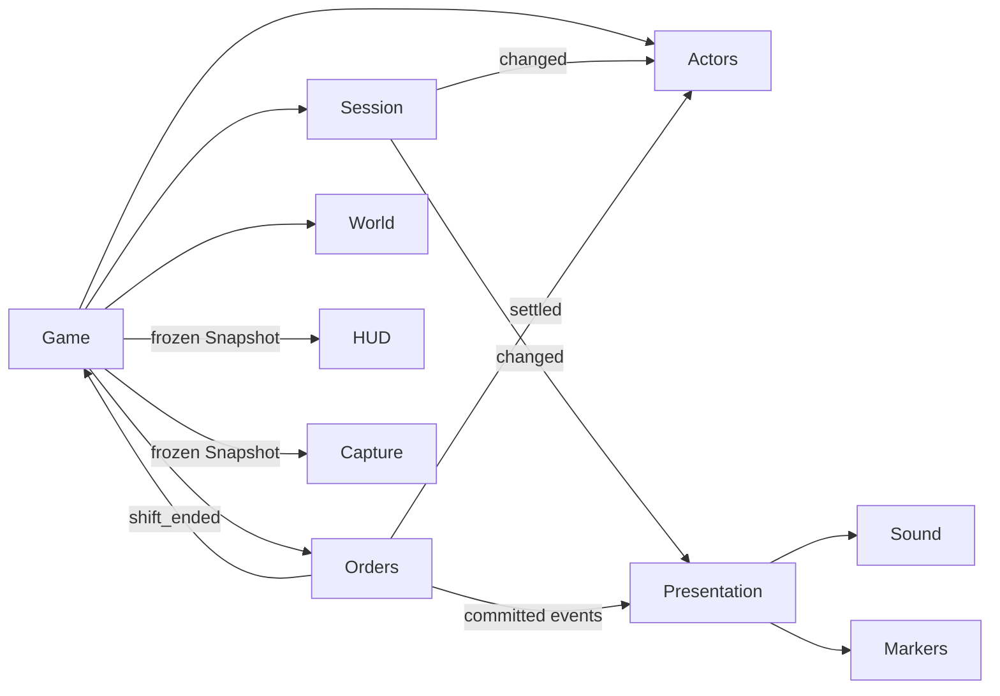

# Gameplay ownership (Phase 03)

Game is the composition root and current distance-based interaction coordinator.
It creates/configures scene-local owners, connects their explicit signals and
exposes compatibility commands. It does not own a second copy of order, cash,
cargo, pause or seated state. No global event bus or empty future managers exist.

| Concern | Real owner | State / interface |
| --- | --- | --- |
| Session/input | `services/session_service.gd`, `session_input.gd` | TITLE/PLAYING/RESULT, generation, modal reason set; input commands always process while the world is paused. |
| Tickets, deadlines, settlement | `services/order_service.gd` | IDLE/AT_SHOP/ON_ROUTE/CLOSED; destination/ticket IDs, RNG, money/deliveries/strikes, remaining time. |
| Current cargo | OrderService | One authoritative carried count for the current prototype. Pip reads it through cargo_source; `set_carrying` only updates meshes. Per-package cargo is Phase 08, not an empty service today. |
| Actor mode/control | `services/actor_controller.gd` | FOOT/DRIVING, exclusive control flags, stop/entry/exit probes, reset and camera target handoff. |
| World references/identity | `services/world_registry.gd` | Validated house/pickup/spawn/body references and stable address lookup; no order/session state. |
| Interaction | Game `interact()` | Existing distance/range selection delegates to order/actor commands; a shared validated target pipeline belongs to Phase 06. |
| Camera movement | `camera_rig.gd` | Existing orbit/chase physics; ActorController supplies target and driving state. Manual camera modes belong to Phase 04. |
| View/effects | `services/presentation.gd`, `sound_presenter.gd` | Derived text/waypoints, markers, sound/toasts/results from committed events. No pay/deadline mutation. |
| HUD/tests | `services/game_snapshot.gd` | Typed frozen values with no Node/service handles; HUD receives only a Callable supplying this read model. |
| Balance configuration | `data/balance.tres`, `services/balance.gd` | Shared Resource: ranges, deadline floor/start/decrease, pay/tip/goal/strikes, stop/exit thresholds. Never mutated during play. |

All service paths above are under `scripts/`. Later traffic/time/weather/story,
progress and save owners should consume stable IDs/committed events. Their
managers and persistence schemas are deliberately not implemented in this refactor.



## Session and lifetime

`SessionService.Flow` is TITLE/PLAYING/RESULT. Modal reasons are independent of
that base flow. `open_modal(reason: StringName)` and `close_modal(reason)` return
bool; multiple different reasons can coexist. Closing one cannot resume another.
An empty reason, duplicate open or unknown close is rejected. `toggle_pause()`
owns only `user_pause`. The effective snapshot session_mode is title/playing/
paused/result; order_lifecycle and actor_mode remain separate fields.

`reset()` increments generation, clears reasons and returns to title. `start()`
starts only from title; `finish(win)` returns to result only from unpaused play.
`changed(event: Dictionary)` emits a read-only value containing flow, generation,
paused and outcome. It also applies the tree pause state. Only SessionInput,
Session and HUD need always-processing behavior; Game/world stay pausable.
Exiting the service tree clears inherited tree pause for a replacement scene.

One Game instance creates one set of services and signal connections. Reset
reuses them, never reconnecting. Scene destruction removes the entire owner graph;
no cached service/node pointers or connections survive in an autoload. Game reset
prepares OrderService and actors before publishing the new session generation,
so subscribers cannot observe a new title generation with the old cash/cargo/body.

## Orders and transaction boundaries

OrderService APIs:

- `set_seed(value: int)`, `reset(next_generation: int)`.
- `force_destination(id: String, available: Array[String]) -> bool`.
- `create_ticket(available: Array[String]) -> bool` sorts stable IDs before seeded
  selection; an explicit destination takes precedence over anti-repeat logic.
- `pickup() -> bool` changes AT_SHOP to ON_ROUTE and sets current cargo once.
- `tick(delta: float, available: Array[String])` updates the active deadline.
- `settle(available, expected_generation: int, expected_order: int) -> bool`.
- `expire(available, expected_generation: int, expected_order: int) -> bool`.
- `tip() -> int`, `close()` and `event(outcome: String, pay: int=0) -> Dictionary`.

Signals `ticket_created`, `picked_up`, `settled`, `timed_out`, `shift_ended` each
carry a read-only Dictionary of generation, order_id, destination_id, outcome,
pay, money, deliveries, strikes, pizzas and cargo_count. There are no live Nodes
or mutable nested values in these payloads.

A terminal ticket marks its lifecycle CLOSED and commits cargo/counters/cash
**before** emitting. Reentrant settle/timeout attempts reject. After subscribers
return, pending next-ticket/result work runs only if generation and ticket ID
still match and the run was not closed. A restart or session end during a callback
cannot create an old session's next ticket or pay/strike a new session. The
expected-generation/order arguments also reject delayed work explicitly.

OrderService owns current prototype money until a later progress ledger exists;
there is no second cash counter in Game/HUD/Pip. Rendering adapters observe IDs
and outcomes, never settle tickets. `close()` cancels pending run work separately
from the per-ticket CLOSED lifecycle. Goal $150, three strikes and current pay
rules are unchanged.

## Identifiers and compatibility

A destination's stable string ID is its validated unique `address` metadata,
for example `2 Marinara Way`. It is independent of child index/order; changing
an address is an intentional ID migration. Labels are presentation data. Ticket
identity is `(session generation, order_id)`; order_id increments within a run
and resets at title restart. No live Node pointer belongs in future save data.

WorldRegistry `ids()`, `destination(id)`, `legacy_id(index)` expose the actual
registry. Only `legacy_id` depends on authoring child order. Capture's old
`order.index` remains a documented compatibility adapter; new correctness plans
use `order.destination_id`. The choices passed to OrderService are stable IDs,
not numeric scene positions. Registry lookup validates unique nonempty addresses
and the existing Door/Park/pickup/spawn/collision contracts.

Game exposes `start_shift() -> bool`, `interact()`, `restart()`,
`force_destination(id) -> bool`, `open_modal(reason)`, `close_modal(reason)`,
`get_snapshot() -> GameSnapshot` and `set_order_seed(value)`. Existing underscore
methods/legacy State/getter fields remain compatibility adapters for Phase 01
fixtures. New consumers should not write them. The legacy combined mode strings
remain in diagnostics so the Phase 02 assertion schema is preserved.

GameSnapshot exposes typed computed getters and a read-only internal dictionary.
It contains primitives/Vector3/Color values only. `to_dictionary()` is an isolated
JSON-compatible copy; changing it cannot change a snapshot or gameplay owner.
HUD gets no mutable Game/service reference. Phase 02 fields remain; additional
fields are generation, session_mode, actor_mode and order_lifecycle. Derived HUD
text, actor position and waypoint values use the same snapshot contract.

`tools/dev_fixture.gd` contains explicit test-only money/timer/mode injection,
teleport/autopilot, expiry/retry/result and teardown adapters. Capture imports it
only for an explicitly requested developer plan; ordinary gameplay never imports
it. `phase01_checks.gd` remains an isolated physics fixture and may inject body
velocities/colliders or restrict the registry for negative tests. Such hooks do
not establish player navigation or authorize arbitrary mutation in JSON.

## Regression commands

```sh
python3 tools/run_checks.py
godot --headless --audio-driver Dummy --path . --script tools/phase03_checks.gd
```

The full suite includes original 137 physics/state assertions, typed snapshot/
modal/transaction/reload checks, order RNG isolation, repeated one/two-delivery
scenarios and deliberately failing fixtures. See `tools/SCENARIOS.md` for the JSON
schema and rendered smoke command. No world/art generation or serialization was
introduced by this refactor.
